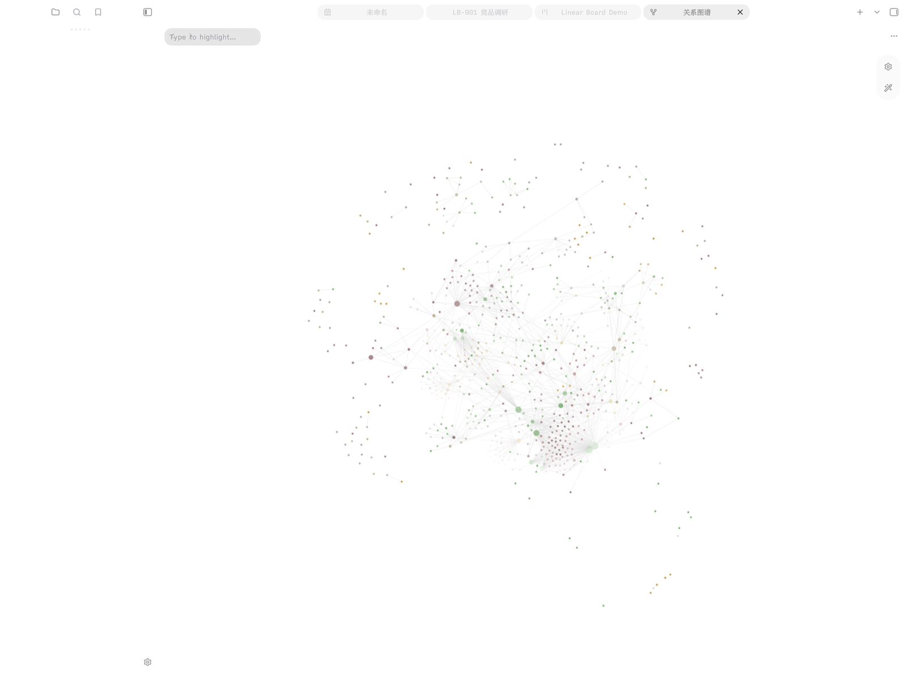

# Crisp Base

> Notion-like database views for [Obsidian](https://obsidian.md) Bases — board, calendar, timeline, relations and gallery, with an editable property inspector. Part of the Crisp plugin suite.



## 0.3.1

- 修复：Base 里其他笔记变动导致视图刷新时，检查器正在编辑的字段会丢失焦点和未提交的文字；标签输入框里打了一半的文字会被当成标签写入。
- 修复：非 Markdown 文件（图片、.base 等）在检查器里显示了无法保存的属性字段，并把文件内容当正文渲染。
- 修复：分组属性是列表类型时，检查器把它当单选写回成字符串；现在用标签式编辑。
- 修复：其他设备通过 iCloud / Obsidian Sync 改了选项颜色后，本机下次保存会覆盖掉；现在会读入外部变更。

## 0.3.0

- 检查器按属性类型显示编辑控件：日期 / 日期时间选择器、数字、勾选、标签式列表（回车添加，候选来自当前 Base）。值与属性类型不符时只显示原文和提示，不会自动转换。
- 视图显示的属性即使笔记里还没有，也能在检查器里直接填写。
- 选项颜色：在列标题右键或检查器下拉里给选项选颜色，按属性名全库共用，看板、画廊、时间线、关联都会跟随。
- 看板每列底部新增「新建」；可在视图设置里指定新建模板（`board.template`），模板属性只补空值，正文写入新笔记。
- 检查器下方显示笔记正文的只读预览，可在右侧分栏打开。

## 0.2.3

- 空日历现在仍显示完整月视图，可直接点击日期创建第一篇带日期的笔记。
- 看板、日历、时间线、关联、画廊及属性检查器的主要界面和视图设置完成中文化。

## Features

- **Board** — Linear-style kanban. Group notes by any property (status, priority, assignee…), drag cards between columns, define column order and always-visible columns.
- **Calendar** — month view driven by any date property, create notes on a day with the date pre-filled.
- **Timeline** — Gantt-style bars from start/end date properties, lanes grouped by any property, today marker, zoom levels.
- **Relations** — aggregate wikilinks and backlinks between the notes in a base; follow relations from chip to chip.
- **Gallery** — cover-image grid (cover property or embedded images) with property chips.
- **Inspector** — every view shares a right-side property panel with typed editors (date, datetime, number, checkbox, list / tags, colored select) and a read-only body preview, writing back to note frontmatter.
- **Option colors** — pick a color per option value (right-click a column header, or from the inspector); colors are shared by property name across the vault.
- **Filters, sort, formulas and summaries** come from the native Bases toolbar — Crisp Base is a rendering layer on top of Bases.

## Requirements

- Obsidian **1.10.2+** (Bases API)
- A **Crisp Suite / Crisp Base activation code** — unactivated, views run in read-only mode with a banner.

## Install

### BRAT

Add `https://github.com/letschips/crisp-base` to BRAT (Beta Reviewers Auto-update Tester) and install as a beta plugin.

### Manual

Download the latest `crisp-base-<version>.zip` from Releases, extract `main.js`, `manifest.json` and `styles.css` into `<vault>/.obsidian/plugins/crisp-base/`, then enable the plugin.

## Usage

1. Activate the plugin in **Settings → Crisp Base**.
2. Open (or create) a `.base` file — Bases is a core plugin.
3. In the view menu, switch the layout to **Crisp Base Board / Calendar / Timeline / Relations / Gallery**.
4. Configure per-view options in the view settings (grouping property, date properties, column order, …).

### Writing a base file by hand

View options are stored as **flat dotted keys** directly under the view — never as a nested map. The view settings panel writes them this way, so a hand-authored base has to match:

```yaml
views:
  - type: crisp-base-board
    name: Board
    board.groupBy: note.status        # not `board:` followed by a `groupBy:` line
  - type: crisp-base-calendar
    name: Calendar
    calendar.dateProperty: note.due
```

Every option follows `<view>.<option>`: `board.groupBy`, `board.extraColumns`, `board.cardLimit`, `board.columnOrder`, `board.template`, `calendar.dateProperty`, `calendar.weekStart`, `timeline.startDate`, `timeline.endDate`, `timeline.groupBy`, `timeline.scale`, `relations.linkProperty`, `relations.groupBy`, `relations.showBacklinks`, `relations.onlyRelated`, `gallery.coverProperty`, `gallery.hideEmptyCover`. A nested map (`board:` → `groupBy:`) parses without an error, but the option is ignored and the view silently falls back to its automatic property detection.

## Development

```bash
npm install
npm run dev      # watch build
npm run check    # tests + lint + type-check + build
npm run deploy -- "<obsidian-vault-path>"
npm run release  # build and zip runtime-only artifacts to ~/Desktop/crisp-base-release
```

## Architecture

- Views register through `Plugin.registerBasesView` (`app/`-style composition: `src/crisp-base-*-view.ts`).
- Data reads come from `BasesQueryResult` (`data`, `config`, `allProperties`); writes go through `fileManager.processFrontMatter`.
- The inspector is shared across views (`src/inspector.ts`).
- Styling is scoped CSS (`.lb-view` / `.cc-*`) — no Tailwind, no React.
- License verification reuses the Crisp suite Ed25519 + online device-check protocol (`src/license.ts`).

## Known limitations

- Not a relational database: relations are wikilink aggregations (`metadataCache.resolvedLinks`); backlink scans are O(n²) for large bases.
- No virtualization yet — boards cap cards per column (default 200, “+N more” raises it).
- Drag & drop is desktop-only; mobile uses the card menu.

## License

Crisp Proprietary License © 2026 letschips. See [LICENSE](LICENSE).
